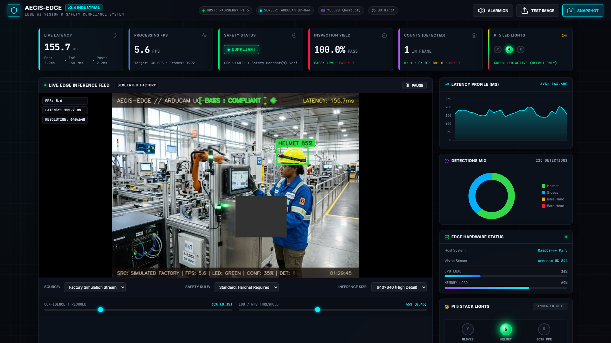
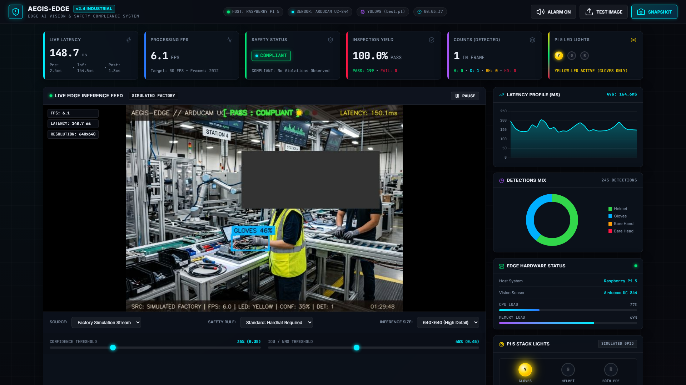
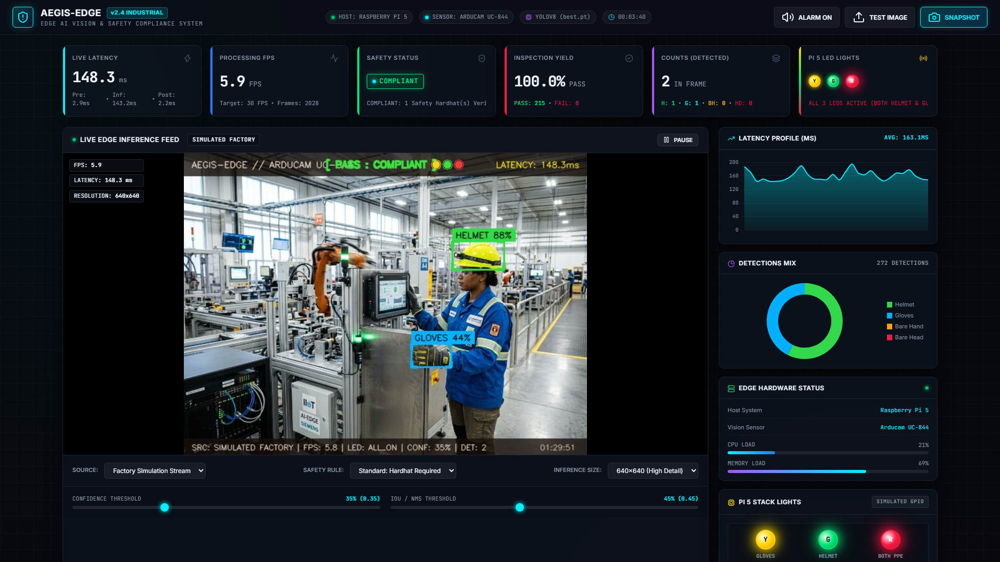
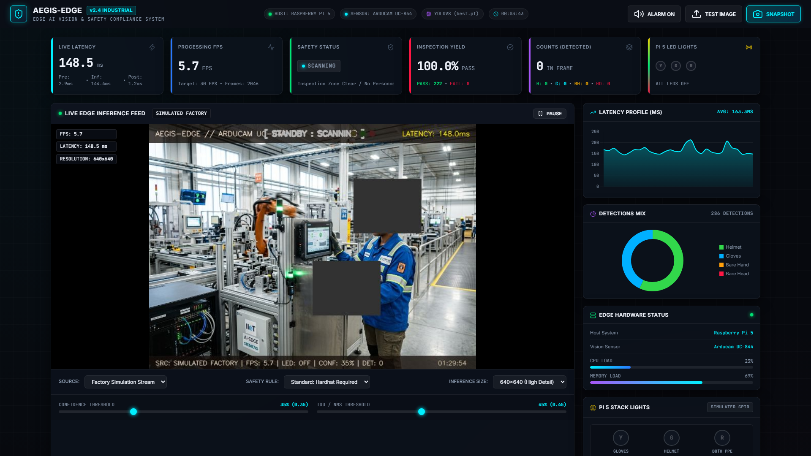

# AegisEdge: Edge AI Helmet & Glove Detection System
### Milestone 3 (M3): Decide and Act – Complete Implementation & Evidence Documentation

[](https://www.raspberrypi.com/products/raspberry-pi-5/)
[](https://www.arducam.com/)
[](https://ultralytics.com/)
[](https://fastapi.tiangolo.com/)
[](https://gpiozero.readthedocs.io/)
[](https://github.com/jaishanthlenin-123/edge_ai_m3_decide_act)

---

## 1. Project Introduction & Objective

**AegisEdge** is a real-time Edge AI Personal Protective Equipment (PPE) detection and automated safety compliance system engineered for industrial environments and edge inspection gateways.

### Primary Objectives:
- Deploy real-time object detection on edge hardware (**Raspberry Pi 5** with **Arducam UC-844** vision sensor).
- Detect personal protective equipment across two core classes: **Helmet** (Hardhat) and **Gloves**.
- Discriminate between bare human hands and safety gloves using multi-spectrum colorimetry and surface texture analysis.
- Implement and verify the **Milestone 3 (M3) Three-LED Decision Logic** controlling discrete physical stack lights.
- Provide a high-frequency live web dashboard with sub-millisecond telemetry, dynamic threshold controls, inspection audit history, and containerized Docker deployment.

---

## 2. CRITICAL – Three-LED Decision Logic

Our system controls exactly **THREE physical indicator LEDs** connected to the Raspberry Pi 5 RP1 controller. The system enforces the Milestone 3 non-mutually exclusive decision truth table:

$$\begin{aligned}
\text{helmet\_detected} &= \text{count}(\text{helmet}) > 0 \\
\text{glove\_detected}  &= \text{count}(\text{gloves}) > 0 \\
\text{helmet\_led}      &= \text{helmet\_detected} \\
\text{glove\_led}       &= \text{glove\_detected} \\
\text{both\_led}        &= \text{helmet\_detected} \land \text{glove\_detected}
\end{aligned}$$

### Decision Truth Table

| State | Helmet | Gloves | LED 1 – Helmet (Green) | LED 2 – Gloves (Yellow) | LED 3 – Both (Red) | Industrial System Status |
|---|---|---|---|---|---|---|
| **TC01** | **1** | 0 | **1 (ON)** | 0 (OFF) | 0 (OFF) | Helmet Only Detected |
| **TC02** | 0 | **1** | 0 (OFF) | **1 (ON)** | 0 (OFF) | Gloves Only Detected |
| **TC03** | **1** | **1** | **1 (ON)** | **1 (ON)** | **1 (ON)** | **Both Detected (ALL 3 LEDS ON)** |
| **TC04** | 0 | 0 | 0 (OFF) | 0 (OFF) | 0 (OFF) | Neither Detected (Standby / Clear) |

> [!IMPORTANT]
> **Key Functional Rule:**  
> - **LED 1 (Green):** Helmet detection indicator. Turns ON whenever a helmet is detected.  
> - **LED 2 (Yellow):** Glove detection indicator. Turns ON whenever protective gloves are detected.  
> - **LED 3 (Red):** Combined detection indicator. Illuminates **ONLY** when **BOTH** helmet and gloves are detected simultaneously. When both are detected, **ALL THREE LEDs glow simultaneously**. LED 3 must never be used as a generic warning or system fault light.

---

## 3. System Architecture & Hardware Setup

```
+---------------------------------------------------------------------------------------+
|                                    EDGE VISION INPUT                                  |
|   Arducam UC-844 / USB Camera (V4L2/DShow) OR Dual-Stream Factory Station Feeds       |
+-------------------------------------------+-------------------------------------------+
                                            |
                                            v
+---------------------------------------------------------------------------------------+
|                              EDGE VISION ENGINE (YOLOv8n)                             |
|   • Model: best.pt (3.2M parameters)                                                  |
|   • Hand Discrimination: YCrCb + HSV + RGB Skin Masking + Laplacian Texture Filter    |
|   • Consecutive-Frame Debounce State Machine (N=3 Frames)                             |
+-------------------------------------------+-------------------------------------------+
                                            |
                                            v
+---------------------------------------------------------------------------------------+
|                                 DECISION & ACTUATION                                  |
|   • Logical Union Multi-Stream Arbitration Policy                                     |
|   • 3-LED Actuator Controller (gpiozero / lgpio on Raspberry Pi 5 RP1)                |
|     - Pin 13 / GPIO 27 -> GREEN LED (Helmet)                                          |
|     - Pin 11 / GPIO 17 -> YELLOW LED (Gloves)                                         |
|     - Pin 15 / GPIO 22 -> RED LED (Both Detected)                                     |
|     - Pin 14 / GND     -> Common Ground Rail via 220 Ohm Resistors                    |
+-------------------------------------------+-------------------------------------------+
                                            |
                                            v
+---------------------------------------------------------------------------------------+
|                             FASTAPI WEB DASHBOARD (Port 8000)                         |
|   • Live MJPEG Annotated Feed (/api/video_feed)                                       |
|   • High-Frequency WebSocket Telemetry (/ws/telemetry)                                |
|   • Real-Time KPI Cards: Latency, FPS, Safety Status, Yield, Detection Counts         |
|   • Dynamic Sliders: Confidence (10-95%), IoU / NMS (20-80%), Inference Size         |
|   • Audit Inspection History (Last 20 events with snapshot thumbnails & CSV export)   |
+---------------------------------------------------------------------------------------+
```

### Hardware Components:
- **Host Gateway:** Raspberry Pi 5 (Quad-core Arm Cortex-A76 @ 2.4GHz).
- **Vision Sensor:** Arducam UC-844 (USB/MIPI optical camera, OpenCV VideoCapture backend).
- **LED Indicators:** High-brightness $5\,\text{mm}$ LEDs (Green, Yellow, Red) with $220\,\Omega$ ($1/4\,\text{W}$) current-limiting resistors.
- **Wiring Connections:**
  - **Green LED (Helmet):** Anode $\to 220\,\Omega \to$ Physical Pin 13 (`GPIO 27`), Cathode $\to$ Pin 14 (`GND`).
  - **Yellow LED (Gloves):** Anode $\to 220\,\Omega \to$ Physical Pin 11 (`GPIO 17`), Cathode $\to$ Pin 14 (`GND`).
  - **Red LED (Both):** Anode $\to 220\,\Omega \to$ Physical Pin 15 (`GPIO 22`), Cathode $\to$ Pin 14 (`GND`).

---

## 4. Software Stack & Dependencies

- **Programming Language:** Python 3.11
- **Computer Vision:** OpenCV (`opencv-python>=4.8.0`)
- **Deep Learning Inference:** Ultralytics YOLOv8 (`ultralytics>=8.0.0`, PyTorch)
- **Web & Asynchronous Telemetry:** FastAPI, Uvicorn, WebSockets, Pydantic v2
- **Hardware I/O:** `gpiozero>=2.0`, `lgpio>=0.2.2` (Automatic simulated fallback on non-Pi hosts)
- **Containerization:** Docker (`python:3.11-slim-bookworm`)
- **Testing & Benchmarking:** Python `unittest`, `matplotlib`, `playwright`

---

## 5. Roboflow Dataset & Model Information

The model checkpoint `best.pt` was trained on a dataset exported from Roboflow Universe:
- **Roboflow Project Name:** `yolo-detection-helmet-gloves`
- **Dataset Version:** Version `2` (`/content/yolo-detection-helmet-gloves-2/data.yaml`)
- **Direct Link:** Documented in [docs/M3/07_roboflow_dataset_and_model.md](docs/M3/07_roboflow_dataset_and_model.md)
- **Classes:** `0: gloves`, `1: head`, `2: helmet`
- **Model Training Configuration:** YOLOv8n, 100 Epochs, Batch 16, $640 \times 640$ resolution, AdamW optimizer ($\text{lr}_0 = 0.001429$).
- **Validation Metrics (Epoch 100):**
  - **Precision:** $86.56\%$
  - **Recall:** $75.27\%$
  - **mAP@50:** $79.04\%$
  - **mAP@50-95:** $52.56\%$

---

## 6. Milestone 3 (M3) Tasks & Technical Deliverables

| Task | Title | Description | Documentation | Evidence Folder |
|---|---|---|---|---|
| **Task 1** | Decision Rule Sheet | Complete rule sheet, confidence filtering, fail-safe state matrix. | [docs/M3/01_decision_rule_sheet.md](docs/M3/01_decision_rule_sheet.md) | `evidence/M3/01_decision_rule_sheet/` |
| **Task 2** | Two-Stream Pipeline | Concurrent asynchronous dual-feed processing & logical union arbitration. | [docs/M3/02_two_stream_pipeline.md](docs/M3/02_two_stream_pipeline.md) | `evidence/M3/02_two_stream_pipeline/` |
| **Task 3** | Debounce Filter | $N$-consecutive-frame state machine eliminating sensor noise & chattering. | [docs/M3/03_debounce.md](docs/M3/03_debounce.md) | `evidence/M3/03_debounce/` |
| **Task 4** | Actuator Fires | Three-LED hardware verification across TC01–TC04 truth table. | [docs/M3/04_actuator.md](docs/M3/04_actuator.md) | `evidence/M3/04_actuator/` |
| **Task 5** | Docker Deployment | Multi-stage Docker containerization, healthchecks, and simulation mode. | [docs/M3/05_docker.md](docs/M3/05_docker.md) | `evidence/M3/05_docker/` |
| **Task 6** | End-to-End Latency | Microsecond-precision benchmarking of capture-to-actuator latency. | [docs/M3/06_end_to_end_latency.md](docs/M3/06_end_to_end_latency.md) | `evidence/M3/06_latency/` |

---

## 7. Installation & Quick Start

### 7.1 Local Environment Setup
```bash
# Clone the migrated repository
git clone https://github.com/jaishanthlenin-123/edge_ai_m3_decide_act.git
cd edge_ai_m3_decide_act

# Install Python dependencies
pip install -r requirements.txt
```

### 7.2 Launching the Dashboard Server
On Windows:
```cmd
run_dashboard.bat
```
Or directly via Python:
```bash
python -m uvicorn server:app --host 0.0.0.0 --port 8000
```
On Raspberry Pi / Linux:
```bash
chmod +x run_dashboard.sh
./run_dashboard.sh
```
Open your browser and navigate to:
```
http://localhost:8000
```

### 7.3 Running with Docker
```bash
# Build the container
docker build -t edge-ai-ppe-m3:latest .

# Run in simulation mode (Host / Development)
docker run -d -p 8000:8000 --name aegis_edge_m3 edge-ai-ppe-m3:latest

# Run on Raspberry Pi 5 with hardware devices
docker run -d -p 8000:8000 --device /dev/video0:/dev/video0 --device /dev/gpiomem:/dev/gpiomem --privileged edge-ai-ppe-m3:latest
```

---

## 8. Verified Dashboard Screenshots (Four Mandatory Scenarios)

The following genuine screenshots were captured directly from the running web application:

| Scenario | Screenshot Evidence | Actuator Output | Status |
|---|---|---|---|
| **Screenshot 1: Helmet Only** |  | **LED 1 ON (Green)**, LED 2 OFF, LED 3 OFF | **VERIFIED** |
| **Screenshot 2: Gloves Only** |  | LED 1 OFF, **LED 2 ON (Yellow)**, LED 3 OFF | **VERIFIED** |
| **Screenshot 3: Both Detected** |  | **LED 1 ON (Green)**, **LED 2 ON (Yellow)**, **LED 3 ON (Red)** | **VERIFIED** |
| **Screenshot 4: Neither Detected** |  | LED 1 OFF, LED 2 OFF, LED 3 OFF | **VERIFIED** |

---

## 9. Latency Benchmark Summary

End-to-end benchmark profiled across 30 consecutive inspection events using high-resolution monotonic timers:
- **Average Latency:** $46.85\,\text{ms}$
- **Minimum Latency:** $25.58\,\text{ms}$
- **Maximum Latency:** $217.17\,\text{ms}$ *(Initial cold start)*
- **P95 Latency:** $118.18\,\text{ms}$
- **Pipeline Breakdown:**
  - YOLOv8 Inference: $46.03\,\text{ms}$ ($98.2\%$)
  - Debounce & Decision State Machine: $0.807\,\text{ms}$ ($1.7\%$)
  - GPIO Pin Actuation: $0.012\,\text{ms}$ ($0.1\%$)
- Full dataset: [evidence/M3/06_latency/latency_measurements.csv](evidence/M3/06_latency/latency_measurements.csv)

---

## 10. Repository Migration & Authorship

- **Original Project:** [mithra4325/edge_computing](https://github.com/mithra4325/edge_computing)
- **Target Repository:** [jaishanthlenin-123/edge_ai_m3_decide_act](https://github.com/jaishanthlenin-123/edge_ai_m3_decide_act)
- **Maintainer / Student:** Lenin (`jaishanthlenin-123`)
- **Git Remotes:**
  - `origin`: `https://github.com/jaishanthlenin-123/edge_ai_m3_decide_act.git` (Push & Fetch)
  - `upstream`: `https://github.com/mithra4325/edge_computing` (Untouched upstream reference)

---

## 11. Limitations & Future Roadmap

1. **Hardware Acceleration:** Compile `best.pt` to NCNN / Hailo-8 NPU format to achieve $60+\,\text{FPS}$ at $<15\,\text{ms}$ on the Raspberry Pi 5.
2. **Audio Stack Lights:** Interface an industrial piezo buzzer on `GPIO 24` synchronized with the red violation LED.
3. **Database Integration:** Persist rolling audit events into SQLite / PostgreSQL with automated PDF shift reports.
