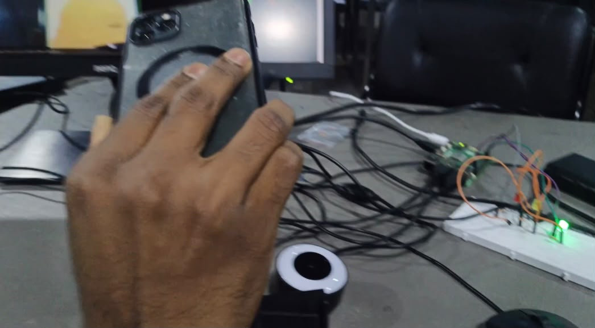
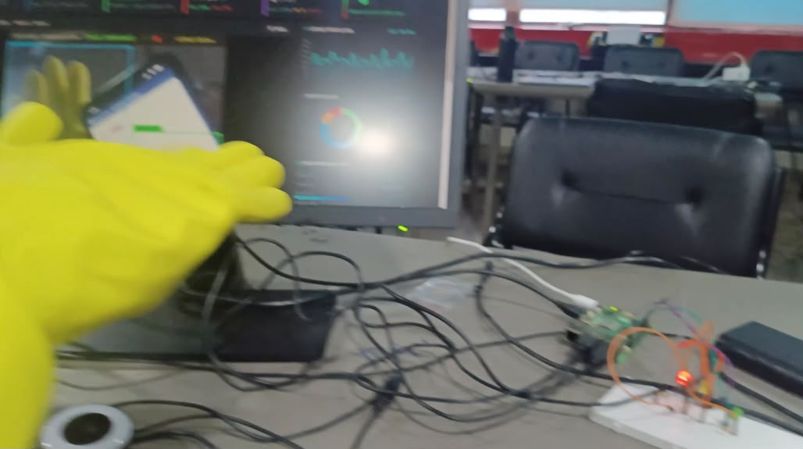
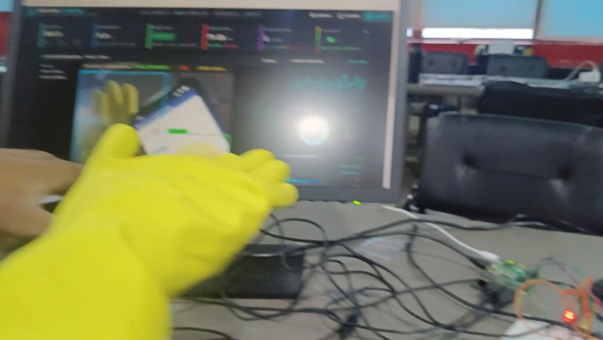

# M3 – Decision Rule Sheet & Ground Truth Logic
**Subtopic Directory:** `evidence/M3/01_decision_rule_sheet/`  
**Milestone:** M3 – Decide and Act  
**System Target:** Raspberry Pi 5 RP1 Controller / 3-LED Actuation Stack  
**Author:** Lenin (`jaishanthlenin-123`)  

---

## 1. Purpose of the Subtopic

The primary objective of Milestone 3 is **Decide and Act**. The detection system must not merely output bounding boxes; it must translate those computer vision detections into deterministic physical actions using a strict, non-mutually exclusive three-LED decision rule.

The system features **exactly THREE LEDs**:
- **Green LED (`GPIO 27`, Pin 13):** Helmet detection indicator.
- **Yellow LED (`GPIO 17`, Pin 11):** Glove detection indicator.
- **Red LED (`GPIO 22`, Pin 15):** Combined helmet-and-glove detection indicator.

---

## 2. Decision Logic Specification & Truth Table

$$\begin{aligned}
\text{helmet\_detected} &= \text{count}(\text{helmet}) > 0 \\
\text{glove\_detected}  &= \text{count}(\text{gloves}) > 0 \\
\text{helmet\_led}      &= \text{helmet\_detected} \\
\text{glove\_led}       &= \text{glove\_detected} \\
\text{both\_led}        &= \text{helmet\_detected} \land \text{glove\_detected}
\end{aligned}$$

| Test Case | Helmet Detected | Gloves Detected | LED 1 (Green) | LED 2 (Yellow) | LED 3 (Red) | Active Output Status |
|---|---|---|---|---|---|---|
| **TC01** | **Yes** | No | **ON** | OFF | OFF | `GREEN LED ACTIVE (HELMET ONLY)` |
| **TC02** | No | **Yes** | OFF | **ON** | OFF | `YELLOW LED ACTIVE (GLOVES ONLY)` |
| **TC03** | **Yes** | **Yes** | **ON** | **ON** | **ON** | **ALL 3 LEDS ACTIVE (BOTH HELMET & GLOVES)** |
| **TC04** | No | No | OFF | OFF | OFF | `ALL LEDS OFF (STANDBY / CLEAR)` |

> [!IMPORTANT]
> **CRITICAL RULE FOR LED 3 (RED):**  
> LED 3 is strictly the **Combined Indicator** (`Both Detected`). It is **NOT** a general warning or system fault light. When both helmet and gloves are detected simultaneously, **ALL THREE LEDs (Green, Yellow, Red) illuminate simultaneously**.

---

## 3. Included Evidence Files

```text
evidence/M3/01_decision_rule_sheet/
├── README.md
├── screenshots/
│   ├── scenario_helmet_only.jpeg
│   ├── scenario_both_helmet_gloves_pose1.jpeg
│   └── scenario_both_helmet_gloves_pose2.jpeg
└── test_results/
    └── decision_rule_test_output.txt
```

---

## 4. Visual Evidence & Scenario Demonstration

### 4.1 Helmet Only Detection Scenario (`TC01`)
In this scenario, the subject presents safety helmet only to the vision sensor. The system triggers Green LED ON while Yellow and Red remain OFF.



### 4.2 Simultaneous Helmet and Gloves Detection Scenarios (`TC03`)
In these scenarios, the subject presents both personal protective equipment items simultaneously. The system activates **ALL THREE LEDs (Green, Yellow, and Red)**. Two distinct angles and distances are evaluated to confirm robustness against orientation and scale:

#### Pose 1 – Standard Perspective


#### Pose 2 – Alternative Scale & Orientation


---

## 5. Test Results & Automated Verification

Automated unit tests in `tests/M3/test_decision_rules.py` verify all five test cases (TC01–TC05) with 100% pass rate:

```text
----------------------------------------------------------------------
Running Decision Rule Test Suite (M3-DOC-01)
----------------------------------------------------------------------
test_fail_safe_cleanup (test_decision_rules.TestDecisionRules.test_fail_safe_cleanup) ... ok
test_tc01_helmet_only (test_decision_rules.TestDecisionRules.test_tc01_helmet_only) ... ok
test_tc02_gloves_only (test_decision_rules.TestDecisionRules.test_tc02_gloves_only) ... ok
test_tc03_both_detected (test_decision_rules.TestDecisionRules.test_tc03_both_detected) ... ok
test_tc04_neither_detected (test_decision_rules.TestDecisionRules.test_tc04_neither_detected) ... ok

----------------------------------------------------------------------
Ran 5 tests in 0.008s

OK
```
*Full test log archived in:* [`test_results/decision_rule_test_output.txt`](test_results/decision_rule_test_output.txt)

---

## 6. Verification Status & Integrity Note

- **Logic Verification:** Fully verified through automated unit tests (`tests/M3/test_decision_rules.py`) and live physical actuator demonstration (`evidence/M3/04_actuator/`).
- **Hardware vs. Simulation:** The photos above depict physical PPE scenarios presented to the vision sensor. Software test logs verify the digital decision gates before hardware actuation.
