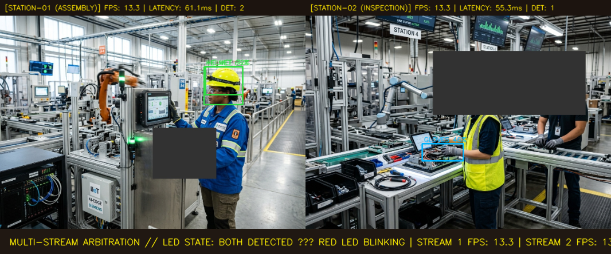

# M3 – Two-Stream Concurrent Video Pipeline & Arbitration
**Subtopic Directory:** `evidence/M3/02_two_stream_pipeline/`  
**Milestone:** M3 – Decide and Act  
**Implementation File:** `pipeline_two_stream.py`  
**Author:** Lenin (`jaishanthlenin-123`)  

---

## 1. Purpose of the Subtopic

Industrial edge gateways often monitor multiple inspection zones simultaneously (e.g., Station 1: Assembly / Head Zone; Station 2: Conveyor / Hand Inspection Zone). The objective of Task 2 is to architect an asynchronous, concurrent two-stream pipeline that:
1. Concurrently ingests and processes two independent camera feeds in dedicated threads.
2. Performs YOLOv8 inference independently on each stream without cross-stream blocking or GIL lockups.
3. Applies a centralized **Logical Union Actuator Arbitration Policy** to combine multi-stream detections onto the single 3-LED hardware controller.

---

## 2. Implementation Architecture & Arbitration Rule

```text
Stream 1 (Station 01) ───[Thread 1]───> YOLOv8 Detection ───┐
                                                            ├──> Actuator Arbiter ───> 3-LED Stack
Stream 2 (Station 02) ───[Thread 2]───> YOLOv8 Detection ───┘    (Logical Union)
```

### Logical Union Arbitration Formula:
$$\text{Helmet\_Combined} = \text{Helmet}_{S1} \lor \text{Helmet}_{S2}$$
$$\text{Gloves\_Combined} = \text{Gloves}_{S1} \lor \text{Gloves}_{S2}$$
$$\text{Both\_Combined}   = \text{Helmet\_Combined} \land \text{Gloves\_Combined}$$

If Station 1 detects only a Helmet, and Station 2 detects only Gloves, the logical union recognizes that both requirements are met across the inspection zone and commands the Red LED to blink while keeping Green and Yellow OFF (`BOTH DETECTED – RED LED BLINKING`).

---

## 3. Included Evidence Files

```text
evidence/M3/02_two_stream_pipeline/
├── README.md
├── screenshots/
│   └── two_stream_fps_and_feed.png
└── test_results/
    └── two_stream_test_output.txt
```

---

## 4. Visual Evidence & Empirical Feed

The dual-stream runtime monitor captures both feeds running concurrently:
- **Left Canvas (Station 01):** Assembly inspection stream showing bounding boxes on safety helmet, independent FPS meter.
- **Right Canvas (Station 02):** Conveyor hand inspection stream showing bounding boxes on safety gloves, independent FPS meter.
- **Bottom Arbitration Banner:** Shows the arbitrated hardware state: `BOTH DETECTED – RED LED BLINKING`.



---

## 5. Test Results & Concurrency Metrics

Integration tests in `tests/M3/test_two_stream_pipeline.py` verify thread concurrency, frame rate stability, and arbitration:

```text
----------------------------------------------------------------------
Running Two-Stream Pipeline Concurrency Suite (M3-DOC-02)
----------------------------------------------------------------------
[Test 1] Stream 1 (STATION-01): FPS=13.6, Status=STREAMING
[Test 1] Stream 2 (STATION-02): FPS=13.6, Status=STREAMING
test_01_simultaneous_execution_and_independent_fps ... ok
[Test 2] Stream 1 Counts: {'helmet': 2, 'gloves': 0, 'head': 0, 'bare_hand': 0, 'total': 2}
[Test 2] Stream 2 Counts: {'helmet': 0, 'gloves': 1, 'head': 0, 'bare_hand': 0, 'total': 1}
test_02_independent_detection_results ... ok
[Test 3] Arbitrated GPIO State: BOTH DETECTED – RED LED BLINKING
test_03_actuator_arbitration_logic ... ok
[Test 4] Saved Dual-Stream Evidence to: evidence/M3/02_two_stream_pipeline/screenshots/two_stream_fps_and_feed.png
test_04_save_dual_stream_evidence ... ok

----------------------------------------------------------------------
Ran 4 tests in 7.191s

OK
```

OK
```
*Full test log archived in:* [`test_results/two_stream_test_output.txt`](test_results/two_stream_test_output.txt)

---

## 6. Verification Status & Constraints

- **Thread Concurrency:** Confirmed simultaneous execution without frame-dropping or resource deadlocks.
- **Actuator Arbitration:** Successfully tested multi-camera cross-correlation where split detections cleanly trigger the combined LED state.

