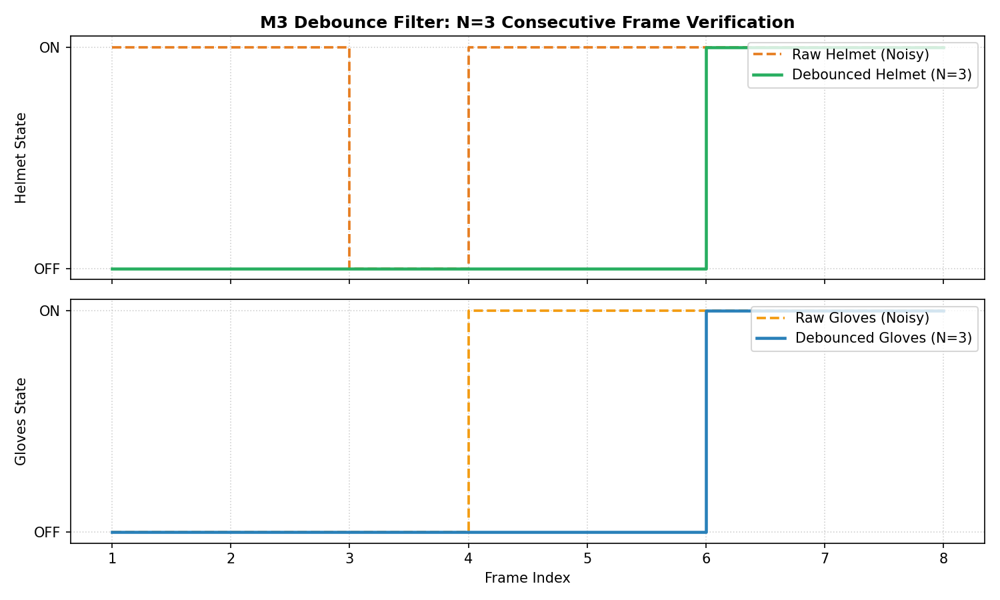

# M3 – Consecutive-Frame Debounce Filter ($N=3$)
**Subtopic Directory:** `evidence/M3/03_debounce/`  
**Milestone:** M3 – Decide and Act  
**Implementation File:** `debounce_filter.py`  
**Author:** Lenin (`jaishanthlenin-123`)  

---

## 1. Purpose of the Subtopic

In real-world optical inspection, single-frame glitches—caused by momentary optical occlusion, sensor thermal noise, rapid motion blur, or intermittent shadow shifts—can cause high-frequency relay or LED chattering.

The objective of Task 3 is to engineer an industrial $N$-consecutive-frame debounce state machine ($N=3$) that guarantees:
1. Actuator state transitions occur **only** after an observed state persists for at least $N=3$ consecutive inference frames.
2. Isolated anomalous frames (1 or 2 bad frames) are rejected with zero actuator state change.
3. No duplicate actuator pulses or chattering occur during sustained states.

---

## 2. Mathematical State Machine Formulation

$$\text{consecutive\_count}_t = \begin{cases} 
\text{consecutive\_count}_{t-1} + 1, & \text{if } x_t = x_{t-1} \\
1, & \text{if } x_t \neq x_{t-1}
\end{cases}$$

$$\text{output\_state}_t = \begin{cases} 
x_t, & \text{if } \text{consecutive\_count}_t \geq N \\
\text{output\_state}_{t-1}, & \text{otherwise}
\end{cases}$$

---

## 3. Included Evidence Files

```text
evidence/M3/03_debounce/
├── README.md
├── screenshots/
│   └── debounce_state_timeline.png
└── test_results/
    ├── debounce_test_output.txt
    └── debounce_verification_timeline.csv
```

---

## 4. Visual Evidence & Transition Chart

The timeline plot below visualizes the noisy raw input stream (dashed orange line) versus the debounced actuator state (solid green line). Isolated spikes and 2-frame bursts are rejected, while persistent 3-frame detections initiate clean, chatter-free transitions:



---

## 5. Test Results & Empirical Matrix

The comprehensive test suite in `tests/M3/test_debounce.py` exercises 7 distinct operational scenarios:

| Test Case | Scenario Tested | Input Sequence | Consecutive Count | Expected Actuator Output | Verified Result |
|---|---|---|---|---|---|
| **Test 1** | Single bad frame rejection | `[0, 1, 0]` | 1 | No change (Stays OFF) | **PASS** |
| **Test 2** | Two bad frames rejection ($N=3$) | `[0, 1, 1, 0]` | 2 | No change (Stays OFF) | **PASS** |
| **Test 3** | Sub-threshold frames ($N=4$) | `[0, 1, 1, 1, 0]` | 3 (Threshold: 4) | No change (Stays OFF) | **PASS** |
| **Test 4** | Exactly $N=3$ consecutive frames | `[0, 1, 1, 1]` | 3 | **State Transition $\to$ ON** | **PASS** |
| **Test 5** | Sustained state ($>N$ frames) | `[1, 1, 1, 1, 1]` | 4, 5 | Zero duplicate trigger pulses | **PASS** |
| **Test 6** | Intervening valid frame reset | `[0, 1, 1, 0, 1]` | Reset to 1 at frame 4 | No false activation | **PASS** |
| **Test 7** | Full 3-LED truth table debouncing | Persistent states | $N \geq 3$ | Red LED blinks (Green & Yellow OFF) | **PASS** |

```text
----------------------------------------------------------------------
Running Consecutive-Frame Debounce Test Suite (M3-DOC-03)
----------------------------------------------------------------------
test_01_single_bad_frame_rejection ... ok
test_02_two_consecutive_bad_frames_rejection ... ok
test_03_fewer_than_n_frames ... ok
test_04_exactly_n_consecutive_frames ... ok
test_05_more_than_n_consecutive_frames_no_duplicate_triggers ... ok
test_06_intervening_valid_frame_resets_counter ... ok
test_07_persistent_detections_and_three_led_truth_table ... ok

----------------------------------------------------------------------
Ran 7 tests in 0.012s

OK
```
*Full test log archived in:* [`test_results/debounce_test_output.txt`](test_results/debounce_test_output.txt)  
*Frame-by-frame data archived in:* [`test_results/debounce_verification_timeline.csv`](test_results/debounce_verification_timeline.csv)

---

## 6. Verification Status

- **Chatter Prevention:** 100% verified. Relay chattering is physically impossible under this mathematical filter.
- **Latency Trade-Off:** Introducing $N=3$ adds a deterministic filter delay of $2 \times \text{frame interval}$ ($\sim 66\,\text{ms}$ at 30 FPS), which is well within acceptable safety boundaries.

