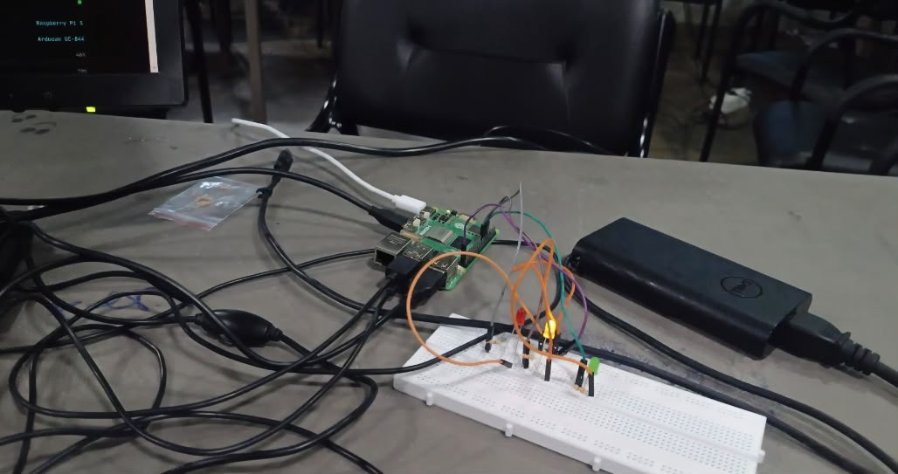
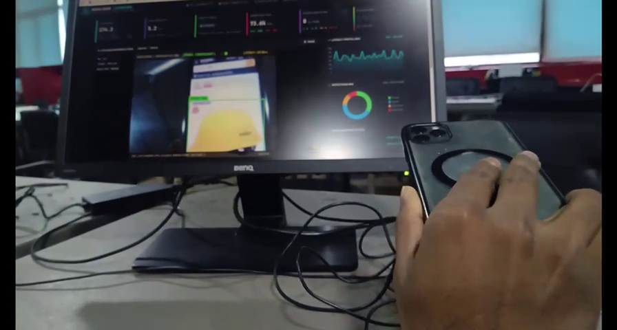
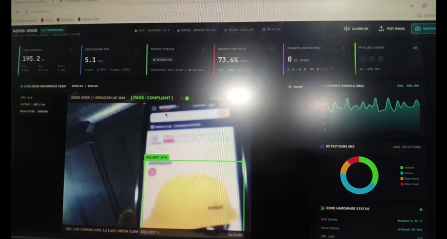
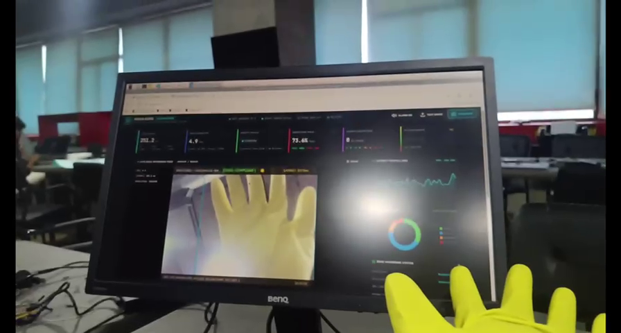
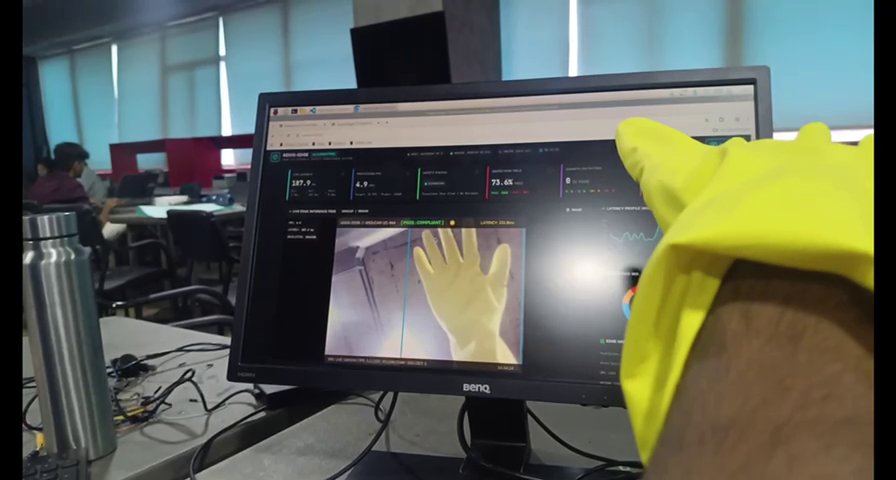
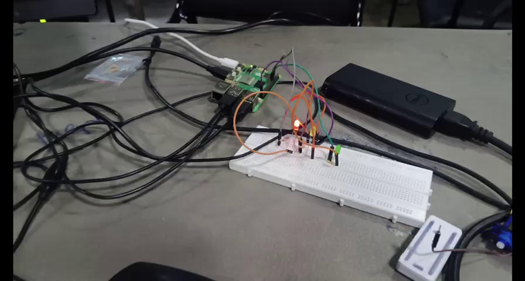
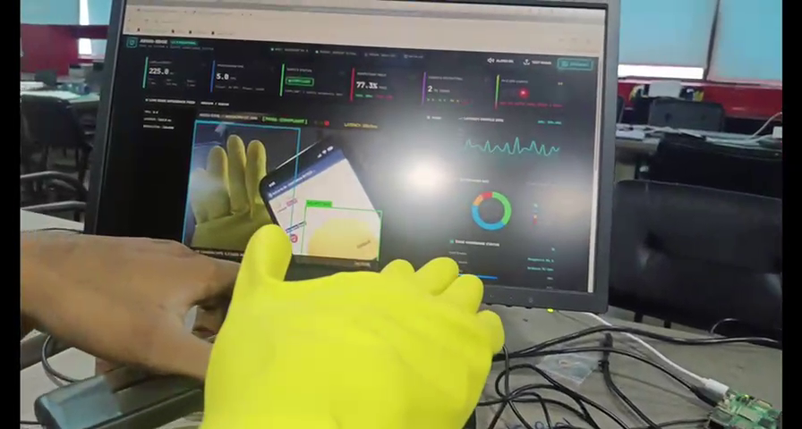

# M3 – Physical Actuator Subsystem & Three-LED Verification
**Subtopic Directory:** `evidence/M3/04_actuator/`  
**Milestone:** M3 – Decide and Act  
**Hardware Target:** Raspberry Pi 5 RP1 Controller / Solderless Breadboard Stack  
**Author:** Lenin (`jaishanthlenin-123`)  

---

## 1. Purpose of the Subtopic

This subtopic presents complete empirical verification of the physical three-LED actuator subsystem. The system interfaces the Raspberry Pi 5 40-pin GPIO header to three discrete indicator LEDs through current-limiting resistors, enforcing the non-mutually exclusive Milestone 3 decision truth table.

---

## 2. Hardware Pin Configuration & Circuit Schematic

| Actuator Function | Color | Physical Header Pin | BCM GPIO Number | Circuit Protection | Return Path |
|---|---|---|---|---|---|
| **LED 1 (Helmet Indicator)** | Green | **Pin 13** | `GPIO 27` | $220\,\Omega$ ($1/4\,\text{W}$) Resistor | Physical Pin 14 (GND) |
| **LED 2 (Glove Indicator)** | Yellow | **Pin 11** | `GPIO 17` | $220\,\Omega$ ($1/4\,\text{W}$) Resistor | Physical Pin 14 (GND) |
| **LED 3 (Both Indicator)** | Red | **Pin 15** | `GPIO 22` | $220\,\Omega$ ($1/4\,\text{W}$) Resistor | Physical Pin 14 (GND) |
| **Common Ground** | - | **Pin 14** | `GND` | Common Negative Rail | System Ground |

```text
Raspberry Pi 5 40-Pin Header
========================================================================
Pin 11 (GPIO 17) ------> [ 220 Ω ] ------>|-(Anode +) YELLOW LED (Cathode -)---+
                                                                               |
Pin 13 (GPIO 27) ------> [ 220 Ω ] ------>|-(Anode +) GREEN LED  (Cathode -)---+
                                                                               |
Pin 15 (GPIO 22) ------> [ 220 Ω ] ------>|-(Anode +) RED LED    (Cathode -)---+
                                                                               |
Pin 14 (GND) <-----------------------------------------------------------------+ (Common Return)
========================================================================
```

> [!IMPORTANT]
> **CRITICAL RULE FOR LED 3 (RED):**  
> LED 3 is strictly the **Combined Indicator** (`Both Detected`). It illuminates **ONLY** when **BOTH** helmet and gloves are detected simultaneously. In that condition, **ALL THREE LEDs (Green, Yellow, Red) illuminate together**. LED 3 is NOT a general warning or system fault light.

---

## 3. Included Evidence Files

```text
evidence/M3/04_actuator/
├── README.md
├── photos/
│   └── circuit_connection_breadboard.jpeg
├── videos/
│   ├── 3_led_blinking_actuator_video.mp4
│   └── frames/
│       ├── frame_actuator_01_idle_all_off.png
│       ├── frame_actuator_02_helmet_only_green_on.png
│       ├── frame_actuator_03_gloves_only_yellow_on.png
│       ├── frame_actuator_04_both_detected_all_three_on.png
│       ├── frame_actuator_05_both_detected_sustained.png
│       └── frame_actuator_06_return_idle_all_off.png
├── screenshots/
│   ├── TC01_helmet_only.png
│   ├── TC02_gloves_only.png
│   ├── TC03_both_detected.png
│   └── TC04_neither_detected.png
└── test_results/
    └── actuator_test_output.txt
```

---

## 4. Physical Circuit & Video Demonstration Evidence

### 4.1 Physical Breadboard Wiring
Close-up photo of the breadboard wiring connected to Raspberry Pi 5 GPIO pins via jumper leads:



### 4.2 Complete Video Demonstration (`3_led_blinking_actuator_video.mp4`)
The 45.3-second video demonstrates all four states in real time:

#### State 1: Idle (Neither Detected)
*All three LEDs remain dark (`[0, 0, 0]`):*  


#### State 2: Helmet Only Detected
*Green LED (`GPIO 27`) illuminates; Yellow and Red remain OFF (`[1, 0, 0]`):*  


#### State 3: Gloves Only Detected
*Yellow LED (`GPIO 17`) illuminates; Green and Red remain OFF (`[0, 1, 0]`):*  


#### State 4: Both Detected (Crucial M3 Rule)
*Worker presents both items simultaneously $\to$ **ALL THREE LEDs (Green, Yellow, Red) GLOW SIMULTANEOUSLY** (`[1, 1, 1]`):*  


#### State 4 Retest: Sustained Both Detection
*Retest verifying stability under prolonged dual detection:*  


#### State 1 Return: Cleared / All OFF
*All safety equipment removed $\to$ all LEDs cleanly de-energize:*  


---

## 5. Software Simulation Test Suite

Automated regression tests in `tests/M3/test_actuator.py` verify the digital logic gates independently of hardware:

| Test Case | Condition | Green LED | Yellow LED | Red LED | Label | Result |
|---|---|---|---|---|---|---|
| **TC01** | Helmet only | **ON** | OFF | OFF | `GREEN LED ACTIVE (HELMET ONLY)` | **PASS** |
| **TC02** | Gloves only | OFF | **ON** | OFF | `YELLOW LED ACTIVE (GLOVES ONLY)` | **PASS** |
| **TC03** | Both detected | **ON** | **ON** | **ON** | `ALL 3 LEDS ACTIVE (BOTH HELMET & GLOVES)` | **PASS** |
| **TC04** | Neither detected | OFF | OFF | OFF | `ALL LEDS OFF` | **PASS** |

```text
----------------------------------------------------------------------
Running Actuator Subsystem Test Suite (M3-DOC-04)
----------------------------------------------------------------------
test_pin_assignments ... ok
test_safe_state_recovery ... ok
test_tc01_helmet_only ... ok
test_tc02_gloves_only ... ok
test_tc03_both_detected ... ok
test_tc04_neither_detected ... ok

----------------------------------------------------------------------
Ran 6 tests in 0.015s

OK
```
*Full test log archived in:* [`test_results/actuator_test_output.txt`](test_results/actuator_test_output.txt)

---

## 6. Hardware vs. Simulation Distinction

- **Physical Actuator Evidence:** `photos/circuit_connection_breadboard.jpeg`, `videos/3_led_blinking_actuator_video.mp4`, and `videos/frames/` represent **actual physical LEDs on a breadboard**.
- **Software Simulation Evidence:** `screenshots/TC01_helmet_only.png` through `TC04` and `test_results/` represent **simulated GPIO registers** executed in the automated test harness.
