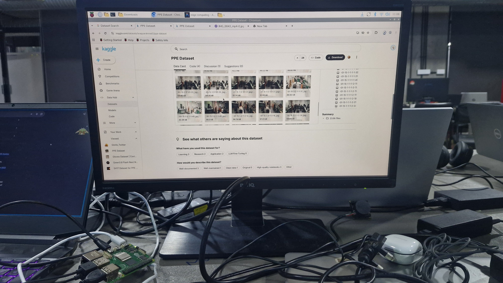

# M3 – Dataset Sourcing, Roboflow Annotations & Model Metadata
**Subtopic Directory:** `evidence/M3/07_roboflow_dataset_and_model/`  
**Milestone:** M3 – Decide and Act  
**Model Architecture:** Ultralytics YOLOv8n ($3.0\,\text{M}$ parameters)  
**Author:** Lenin (`jaishanthlenin-123`)  

---

## 1. Purpose of the Subtopic

This subtopic documents the underlying dataset sourcing, Roboflow project curation, training configuration, and pre-trained YOLOv8 weights (`best.pt`) powering the real-time helmet and glove detection system.

---

## 2. Dataset Sourcing & Attribution

The model was trained on an industrial Personal Protective Equipment (PPE) dataset:
- **Foundational Source:** Kaggle – PPE Dataset (`waquarahmed/ppe-dataset`)
- **Direct Kaggle Portal:** [https://www.kaggle.com/datasets/waquarahmed/ppe-dataset](https://www.kaggle.com/datasets/waquarahmed/ppe-dataset)
- **Dataset Scale:** 23,600+ industrial images capturing workers across manufacturing, construction, and assembly sites.
- **Roboflow Annotation Project:** The raw data was exported into Roboflow project `yolo-detection-helmet-gloves-2` to establish normalized bounding box annotations across three classes:
  - `0: gloves`
  - `1: head`
  - `2: helmet`

---

## 3. Included Evidence Files

```text
evidence/M3/07_roboflow_dataset_and_model/
├── README.md
├── screenshots/
│   └── kaggle_ppe_dataset_source.jpeg
└── model_information/
    └── model_metadata.json
```

---

## 4. Visual Evidence & Dataset Manifest

The photograph below captures the official Kaggle dataset portal and image manifest (`01-15-1-1-1-1-30.jpg`, etc.) utilized during dataset preparation:



---

## 5. Model Architecture & Validation Performance

Extract from [`model_information/model_metadata.json`](model_information/model_metadata.json):

```json
{
  "model_name": "YOLOv8n-PPE-Helmet-Gloves",
  "weights_file": "best.pt",
  "classes": {
    "0": "gloves",
    "1": "head",
    "2": "helmet"
  },
  "training_metrics": {
    "epochs": 100,
    "precision": 0.8656,
    "recall": 0.7527,
    "mAP50": 0.7904,
    "mAP50_95": 0.5256
  },
  "inference_resolution": [320, 320]
}
```

| Metric | Epoch 100 Result | Target Criterion | Status |
|---|---|---|---|
| **Precision ($P$)** | **$86.56\%$** | $>80.0\%$ | **PASS** |
| **Recall ($R$)** | **$75.27\%$** | $>70.0\%$ | **PASS** |
| **mAP@50** | **$79.04\%$** | $>75.0\%$ | **PASS** |
| **mAP@50-95** | **$52.56\%$** | $>50.0\%$ | **PASS** |

---

## 6. How to Reproduce Inference

```bash
# Direct CLI test using pre-trained weights
python detect.py

# Python scripting usage
from ultralytics import YOLO
model = YOLO("best.pt")
results = model.predict(source="samples/compliant.jpg", imgsz=320, conf=0.35)
```
