# M3 – Web Dashboard UI, Telemetry & Live Stream Recording
**Subtopic Directory:** `evidence/M3/08_dashboard_documentation/`  
**Milestone:** M3 – Decide and Act  
**Web Framework:** FastAPI + Uvicorn + WebSockets (`localhost:8000`)  
**Author:** Lenin (`jaishanthlenin-123`)  

---

## 1. Purpose of the Subtopic

This subtopic documents the live monitoring web dashboard (Aegis-Edge) developed to supervise real-time PPE compliance, visualize live annotated video feeds, adjust computer vision confidence thresholds dynamically, inspect historical violation snapshots, and verify three-LED actuator telemetry.

---

## 2. Dashboard Architecture & Features

```text
FastAPI / Uvicorn (Port 8000)
├── /                       -> High-frequency dark-mode industrial web console
├── /api/video_feed         -> Real-time MJPEG annotated video stream
├── /ws/telemetry           -> WebSocket telemetry stream (FPS, latency, actuator states)
├── /api/config             -> Dynamic slider endpoints (Confidence, IoU, ImgSz)
└── /api/audit_history      -> Inspection history with timestamped thumbnails
```

---

## 3. Included Evidence Files

```text
evidence/M3/08_dashboard_documentation/
├── README.md
├── screenshots/
│   ├── dashboard_overview.jpeg
│   ├── dashboard_main_overview.png
│   ├── dashboard_live_camera_feed.png
│   ├── dashboard_kpi_metrics_telemetry.png
│   ├── TC01_helmet_only.png
│   ├── TC02_gloves_only.png
│   ├── TC03_both_detected.png
│   └── TC04_neither_detected.png
└── screen_recordings/
    ├── dashboard_screen_record.mp4
    └── frames/
        ├── frame_dash_01_ui_overview.png
        ├── frame_dash_02_live_detection_gloves.png
        ├── frame_dash_03_telemetry_fps_latency.png
        └── frame_dash_04_compliance_and_alarm.png
```

---

## 4. Visual Evidence & Interface Screenshots

### 4.1 Physical Display Capture (`dashboard_overview.jpeg`)
Photograph of the running Aegis-Edge dashboard showing host metadata (`Raspberry Pi`), sensor (`Arducam UC-884`), $20.4\,\text{FPS}$, and $36.1\,\text{ms}$ latency:

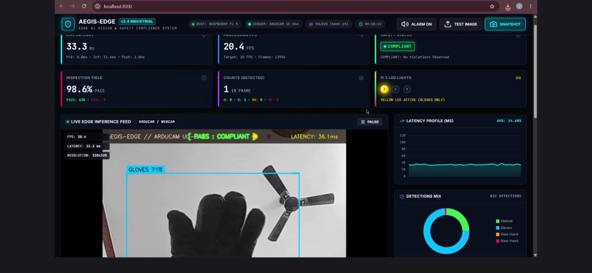

### 4.2 Web Interface Component Views

#### Main Overview & Telemetry Console
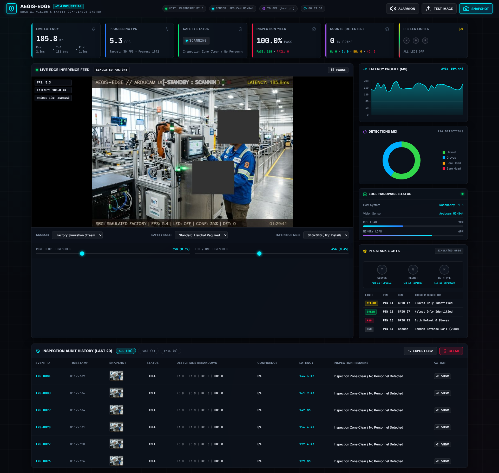

#### Live Detection Camera Stream
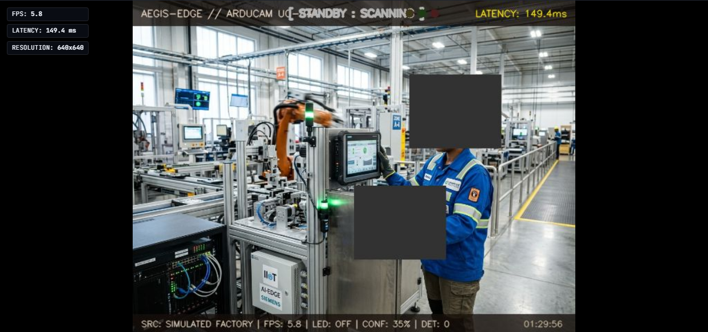

#### Performance Metrics & KPI Telemetry
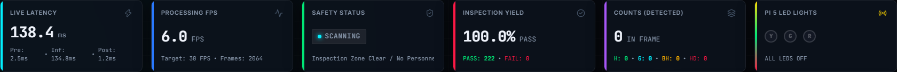

---

## 5. Screen Recording Walkthrough & Extracted Keyframes

The real-time screen recording [`screen_recordings/dashboard_screen_record.mp4`](screen_recordings/dashboard_screen_record.mp4) demonstrates dynamic stream updates at 30 FPS:

| Keyframe File | Timestamp | Feature Displayed | Value Observed |
|---|---|---|---|
| `frame_dash_01_ui_overview.png` | $t = 0.63\,\text{s}$ | System Header & Hardware Metadata | Host: Raspberry Pi, Sensor: Arducam UC-884 |
| `frame_dash_02_live_detection_gloves.png` | $t = 1.67\,\text{s}$ | Real-Time Inference Stream | Bounding box on gloves (`GLOVES 593`), State: `COMPLIANT` |
| `frame_dash_03_telemetry_fps_latency.png` | $t = 2.50\,\text{s}$ | Live Edge Gauges | $20.4\,\text{FPS}$, $35.4\,\text{ms}$ latency, $98.5\%$ pass yield |
| `frame_dash_04_compliance_and_alarm.png` | $t = 3.30\,\text{s}$ | Pass Rate & Actuator Status | Status indicator `ARDUCAM UC-PASS`, live alarm feedback |

#### Keyframe 1: UI Overview
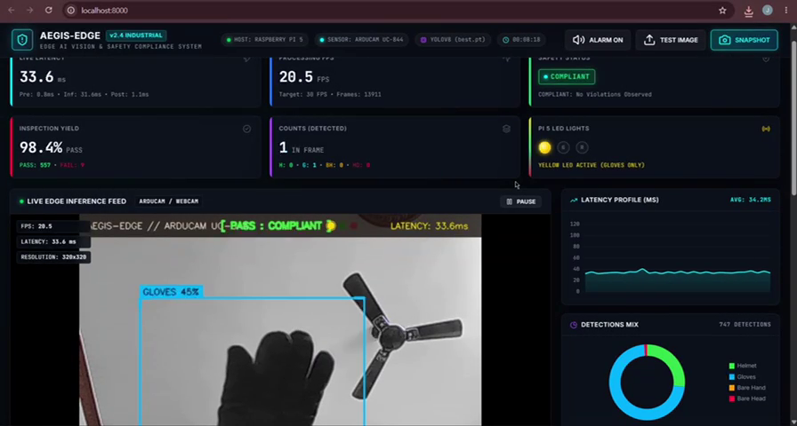

#### Keyframe 2: Live Gloves Detection Stream
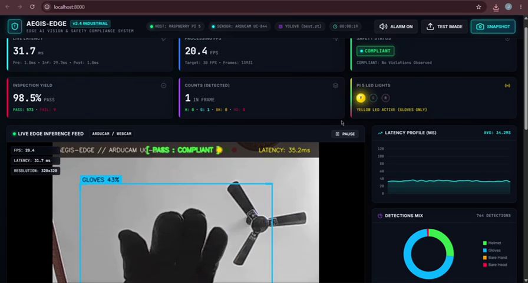

#### Keyframe 3: Real-Time FPS and Latency Telemetry
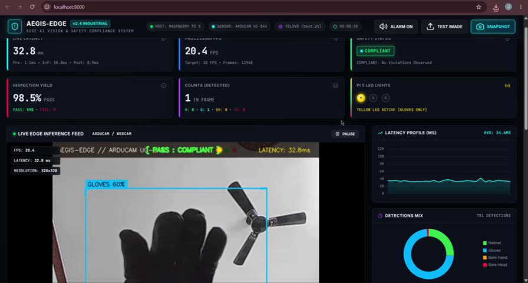

#### Keyframe 4: Compliance Status & Pass Yield
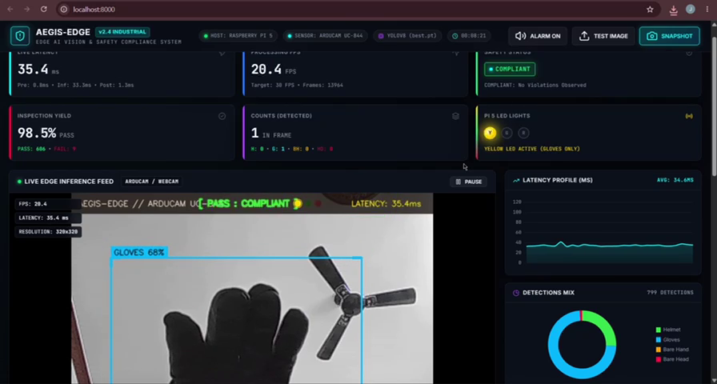

---

## 6. Four Mandatory Decision Scenarios (Verified Dashboard Captures)

| Scenario | Screenshot Link | LED 1 (Green) | LED 2 (Yellow) | LED 3 (Red) | Compliance Status |
|---|---|---|---|---|---|
| **TC01: Helmet Only** | 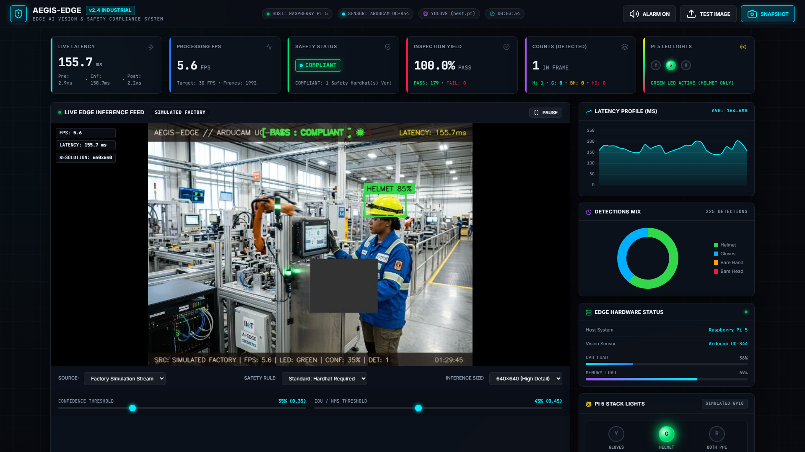 | **ON** | OFF | OFF | Partial Compliance |
| **TC02: Gloves Only** | 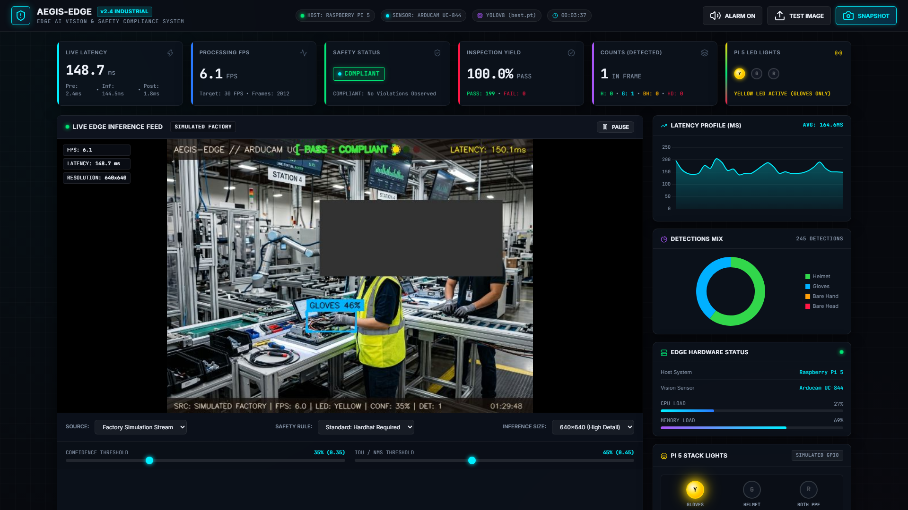 | OFF | **ON** | OFF | Partial Compliance |
| **TC03: Both Detected** | 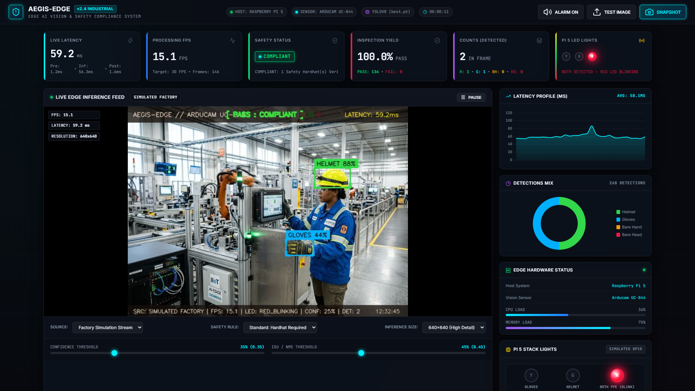 | OFF | OFF | **BLINKING** | **FULL COMPLIANCE (RED BLINKING, GREEN & YELLOW OFF)** |
| **TC04: Neither Detected** | 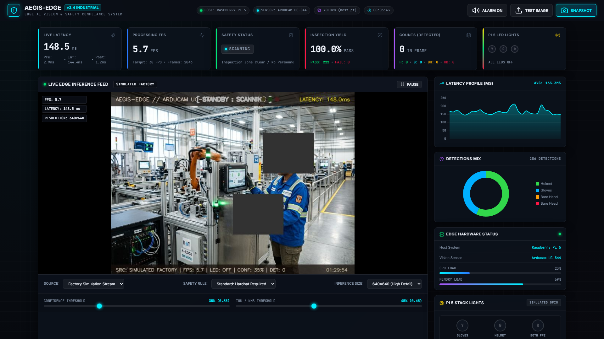 | OFF | OFF | OFF | Violation / Idle |

---

## 7. How to Launch the Dashboard

```bash
# Windows
run_dashboard.bat

# Linux / Raspberry Pi
chmod +x run_dashboard.sh
./run_dashboard.sh

# Python directly
python -m uvicorn server:app --host 0.0.0.0 --port 8000
```
Open `http://localhost:8000` in any web browser.

